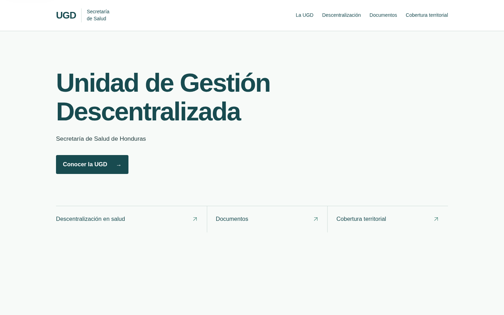
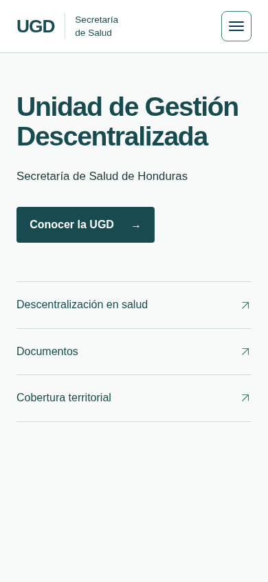

# Fase 7 — Portada institucional cercana

Prototipo para revisión interna de la coordinadora. No constituye identidad oficial ni aprobación editorial. Base: `main`, commit `6421362`, PR #18 fusionado. Sin despliegue ni fusión.

## Implementación y decisiones

- `index.html`: identificación provisional tipográfica UGD/Secretaría de Salud, título institucional, identificación de Honduras, una acción principal y tres enlaces. Sin mapas, cifras, explicaciones ni tarjetas en la portada.
- `portal.html`: conserva las consultas y sus anclas, presentación institucional independiente, biblioteca, atlas, observatorio y registros históricos. Solo agrega el destino mínimo `#descentralizacion` con contenido pendiente y navegación a los módulos existentes. No cambia los datos ni los avisos del PR #18.
- `src/landing.js`: inicializa el menú existente y conserva enlaces antiguos con anclas o parámetros mediante redirección relativa. La portada no solicita archivos territoriales.
- `src/styles.css`: estilos acotados a portada y encabezado, fuentes del sistema, ancho máximo 1120 px, espacios generosos y bordes discretos. En móvil, enlaces verticales; a partir de 851 px, distribución horizontal. Sin imágenes institucionales inventadas, animaciones nuevas, gradientes o sombras en la portada.
- `src/main.js`: deja de ejecutar el bloque de cifras retirado de la portada. Los módulos y datos territoriales mantienen su lógica.
- `scripts/build.mjs` y `tests/audit.test.mjs`: incluyen la página de consultas en el artefacto y su prueba de publicación.
- `scripts/browser-check.mjs`: sustituye expectativas del hero cartográfico retirado por comprobaciones de la portada; conserva las regresiones de los módulos.

Esta selección de composición sustituye, para esta fase, las alternativas todavía abiertas en [PRODUCT](../../PRODUCT.md) §6 y [sistema visual](../../visual-system.md) §11. Se aplica la excepción explícita del encargo: la portada identifica y orienta, las secciones explican. La [arquitectura](../../architecture.md) describe una versión anterior al PR #18: la presentación ya es estática e independiente del archivo; ahora también lo es toda la portada. Estas decisiones no autorizan un rediseño interior.

## Contraste de la paleta exploratoria

Cálculo de luminancia relativa sRGB conforme a WCAG:

| Uso | Colores | Relación |
| --- | --- | --- |
| Texto principal/enlaces sobre superficie | #184B50 / #F7FAF8 | 9,25:1 |
| Encabezado y botón principal | #184B50 / #FFFFFF | 9,72:1 |
| Texto secundario sobre superficie | #203B3D / #F7FAF8 | 11,39:1 |
| Botón en hover | #FFFFFF / #397F72 | 4,72:1 |
| Foco y flechas sobre superficie | #397F72 / #F7FAF8 | 4,49:1 |

El verde secundario sobre la superficie clara se limita a señales gráficas/foco (supera 3:1), no a texto normal (no alcanza 4,5:1). Las líneas claras son separadores decorativos; no identifican por sí solas controles. La marca es texto provisional, no un logotipo oficial.

## Verificación local

Chromium 156.0.8078.79, Playwright 1.64.1, Linux; rutas servidas por interceptación local bajo `/ugd/`.

- `npm test`: 40/40.
- `npm run validate`: correcto.
- `npm run build`: correcto; ambas entradas HTML incluidas, sin cambios en el contrato de datos.
- `CHROME_PATH=/usr/bin/chromium SCREENSHOT_DIR=artifacts/screenshots npm run test:browser`: correcto. Portada, cuatro destinos, recarga, volver, enlaces antiguos, menú con Enter/Tab/Escape y retorno del foco, ausencia de enlaces ocultos en el orden de tabulación; sin desbordamiento a 320, 390, 768, 850, 1024 y 1440 px; texto al 200 % con espaciado aumentado en móvil. Regresiones de atlas, filtros, teclado, navegación, descargas, observatorio, registros, ocho fallos/recuperaciones y archivo sin cortes.
- `CHROME_PATH=/usr/bin/chromium npm run test:admin-browser`: correcto; administración sin cambios.
- `git diff --check`: correcto.
- Revisión visual de capturas reales: escritorio 1440 × 900 y móvil 390 × 844. Jerarquía institucional, acción principal distinguible y tres accesos legibles; sin saturación ni desplazamiento horizontal. Se corrigieron una flecha no soportada por la fuente y el desbordamiento con texto ampliado.
- Recursos: prueba de ausencia de solicitudes de archivo territorial/geometría en la portada. No se añadieron fuentes remotas, dependencias ni servicios. No se midieron tiempos bajo red real ni se realizó comparación cuantitativa de rendimiento con la base.

## Limitaciones y pendientes

- Validar composición y vocabulario con la coordinadora y realizar pruebas de tareas con visitantes. Las capturas no prueban usabilidad.
- Identidad, presentación, funciones, autoridades y explicación de descentralización pendientes de validación institucional. La biblioteca sigue derivada de fuentes territoriales históricas.
- No se certifica WCAG 2.2 AA: faltan auditoría integral, lector de pantalla, dispositivos físicos y otros motores. El ensayo de texto ampliado no equivale a probar todas las combinaciones de zoom del navegador.
- Las consultas interiores conservan su diseño y contenido preexistentes, incluido el modelo del prototipo; no se presentan como una nueva explicación oficial validada.
- Los enlaces antiguos requieren JavaScript para la redirección. Los nuevos enlaces a `portal.html` y el contenido institucional estático funcionan sin esa redirección.
- No se publica una preview. Las capturas de revisión están en `docs/`, fuera del build público.
